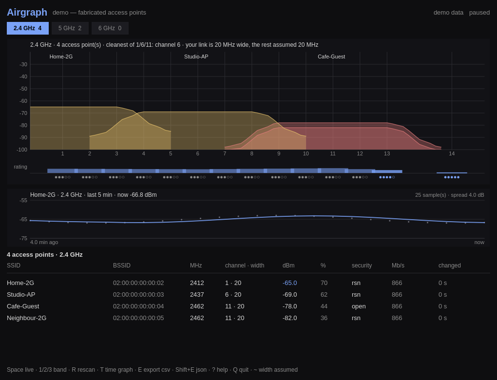

# Airgraph





## Fedora package (COPR)

```sh
sudo dnf copr enable wegweg7979/airgraph
sudo dnf install airgraph
```


## Licence

MIT. The window shape, theme follower and translator follow Omarchy's own apps
(Omacut/Monologue, MIT © David Heinemeier Hansson) — see `LICENSE`.
